DormLaundry - расписание стиралок общежития

Fullstack-приложение для бронирования стиральных и сушильных машин в общежитии.

Назначение приложения
Приложение предназначено для студентов, проживающих в общежитии, для просмотра статуса стиральных и сушильных машин, а также бронирования удобного времени стирки. Цель - избавление от живых очередей и оптимизация времени студентов.

Основные пользовательские сценарии
1. Студент: Регистрация и авторизация в системе (JWT Access + Refresh).
2. Студент: Просмотр списка доступных машин и их текущего статуса из PostgreSQL.
3. Студент: Выбор машины и бронирование свободного двухчасового слота в расписании.
4. Студент: Просмотр своих активных бронирований и их отмена.
5. Студент: Просмотр и редактирование данных личного профиля (комната, контактный Telegram).
6. Администратор: Управление статусом оборудования и мониторинг нагрузки.

Интерфейс приложения (Скриншоты экранов)

1. Каталог оборудования (Десктопная версия)
Отображение доступных стиральных и сушильных машин с фильтрацией по типу и статусам.
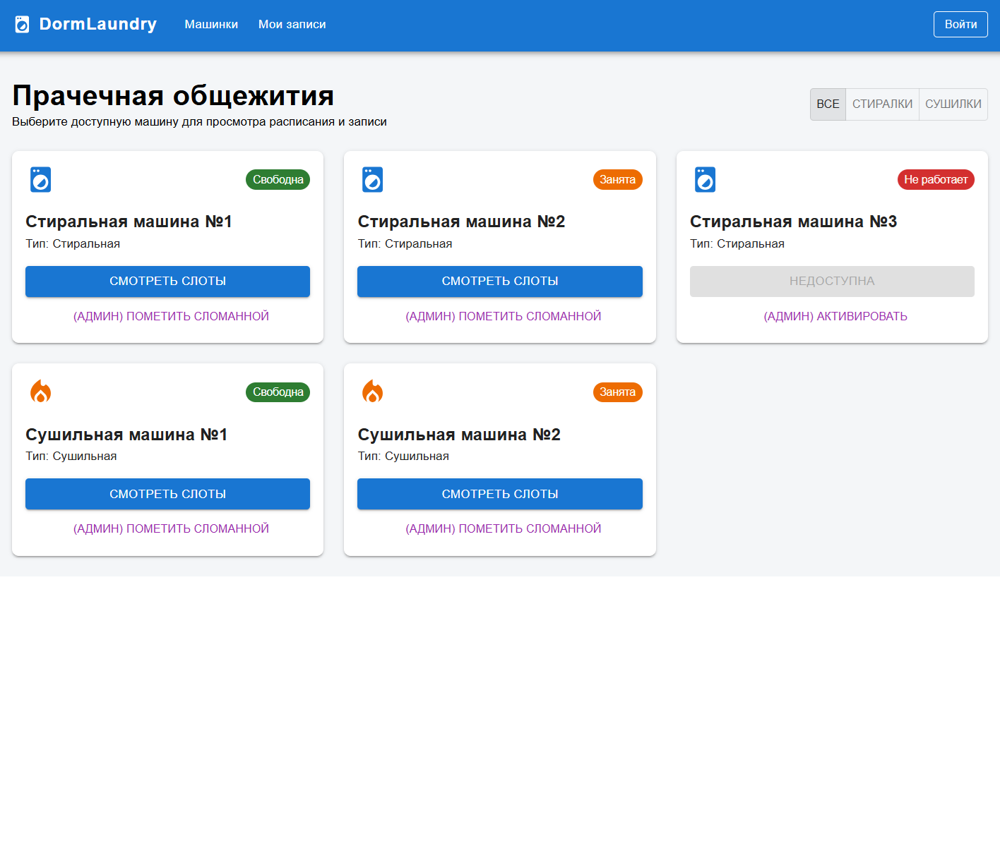

2. Мобильное представление
Адаптивная верстка интерфейса для экранов смартфонов (ширина до 600px).
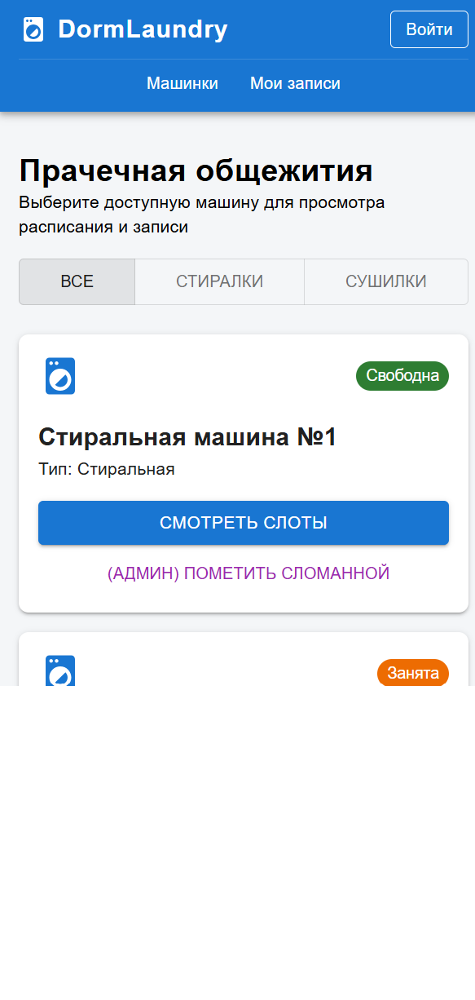

3. Расписание и бронирование слотов
Сетка доступных и занятых временных интервалов с возможностью бронирования.
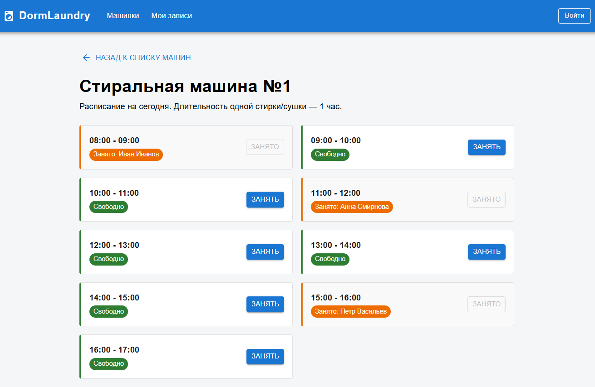

4. Мои бронирования
Список активных записей пользователя с возможностью их отмены.
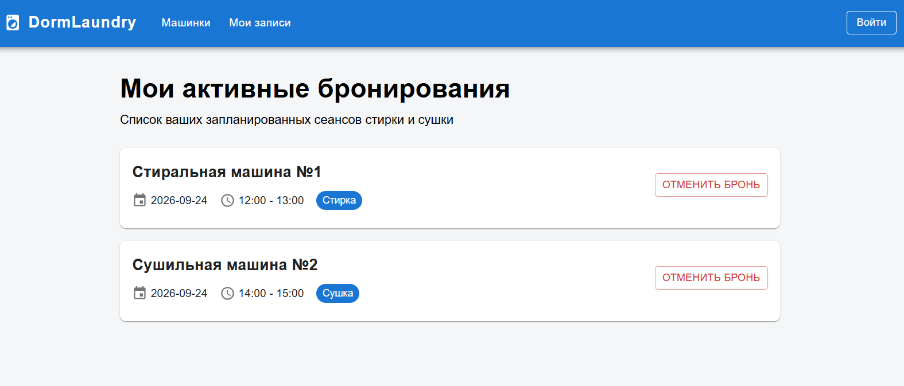

5. Авторизация и регистрация
Форма входа и создания учетной записи для жильцов общежития.
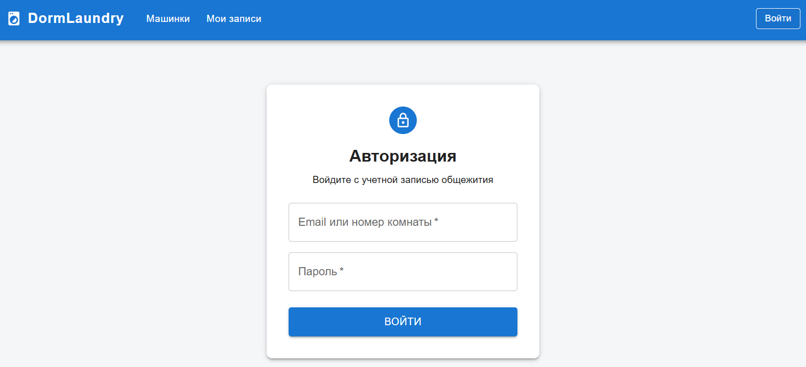

6. Подтверждение бронирования интервала
Диалоговое окно бронирования слота с индикацией отправки.
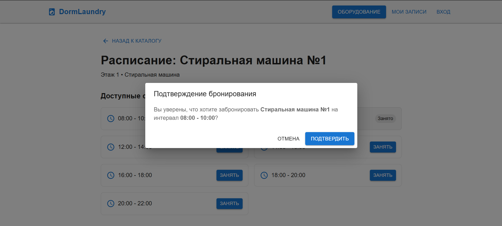

7. Валидация формы авторизации и вывод ошибок
Интерактивная валидация полей ввода с подсказками.
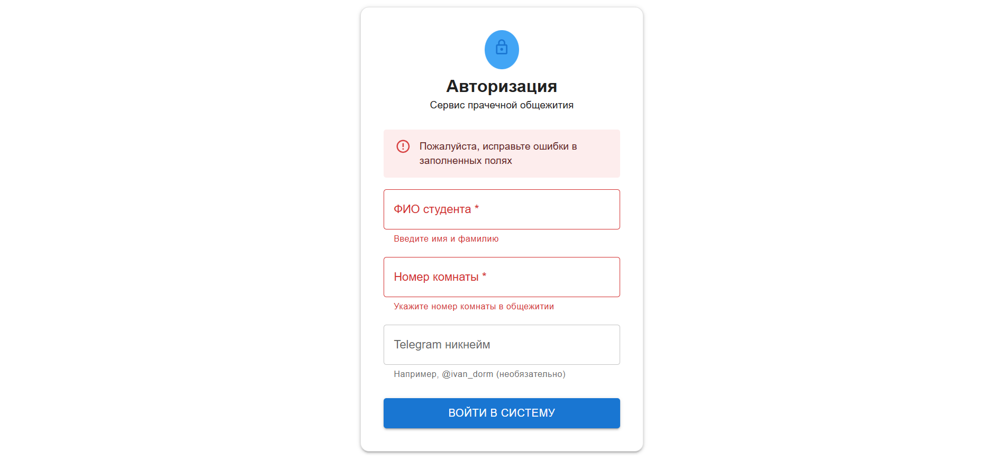

8. Состояние отсутствия данных при фильтрации
Информативное пустое состояние при отсутствии подходящего оборудования.
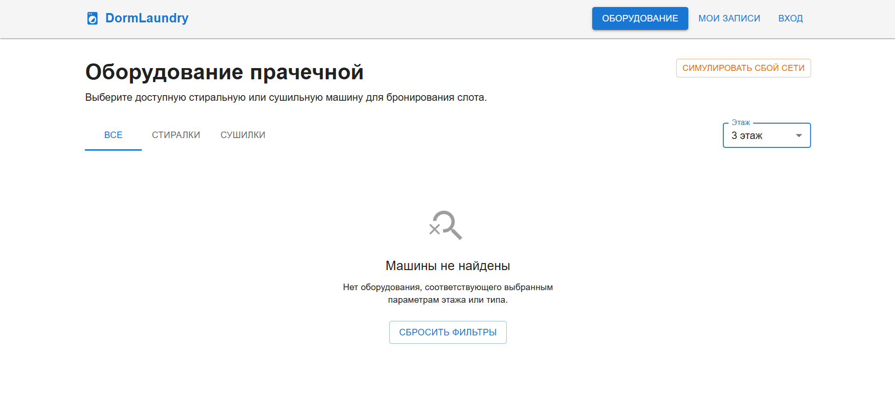

9. Состояние ошибки сети с кнопкой повтора
Обработка недоступности сервера бэкенда с возможностью повторного запроса.
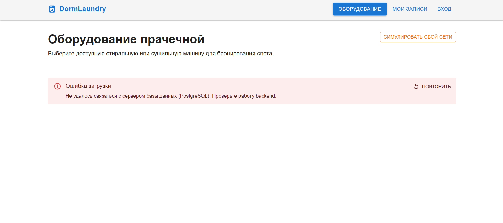

10. Редактирование профиля студента
Диалог изменения личных данных студента с отправкой PUT-запроса в API.
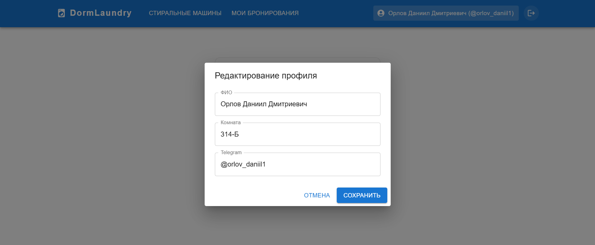

11. Разграничение доступа к личным бронированиям
Блокировка доступа к личным записям для неавторизованных пользователей.
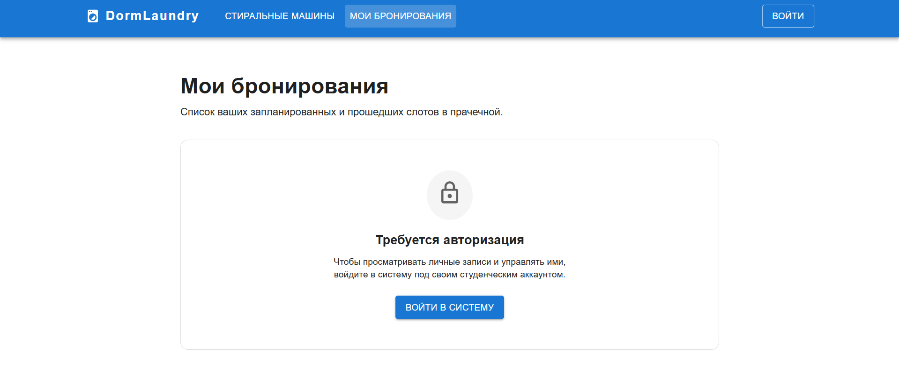

Инструкция по локальному запуску

Предварительные требования
- Node.js (версия 18 или выше) и npm
- Python 3.10+
- СУБД PostgreSQL (с созданной базой данных `dorm_laundry`)

1. Клонирование репозитория
git clone https://github.com/qpdle/dorm-laundry-app.git
cd dorm-laundry-app

2. Запуск Backend (FastAPI + PostgreSQL)
В первом терминале:
cd backend
.\venv\Scripts\Activate.ps1
pip install -r requirements.txt
uvicorn app.main:app --reload

3. Запуск Frontend (React + Vite)
Во втором терминале:
cd frontend
npm install
npm run dev

4. Автоматическое интеграционное тестирование
В третьем терминале при запущенном бэкенде:
cd backend
.\venv\Scripts\Activate.ps1
python test_fullstack_flow.py